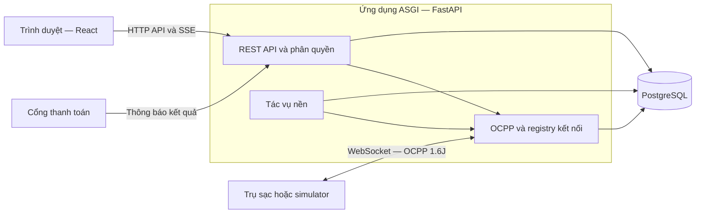

# CSMS — Charging Station Management System

CSMS là hệ thống quản lý vận hành và thanh toán cho mạng lưới trạm sạc xe điện. Hệ thống kết nối trụ sạc qua OCPP 1.6J, theo dõi trạng thái đầu nối và phiên sạc, áp dụng biểu giá theo thời gian, quản lý ví tài xế và cung cấp dữ liệu phục vụ đối soát. Các nghiệp vụ này được liên kết từ thao tác của người dùng trên giao diện đến bản tin của trụ và giao dịch trong cơ sở dữ liệu.

Repository bao gồm backend FastAPI, frontend React, migration PostgreSQL, bộ giả lập trụ OCPP và công cụ vận hành. Giao diện được tổ chức theo vai trò để tài xế, chủ trạm, vận hành viên, kế toán và quản trị viên làm việc trên cùng hệ thống với phạm vi dữ liệu phù hợp.

## Nội dung

- [Phạm vi hệ thống](#phạm-vi-hệ-thống)
- [Kiến trúc và công nghệ](#kiến-trúc-và-công-nghệ)
- [Cấu trúc repository](#cấu-trúc-repository)
- [Khởi chạy trên máy phát triển](#khởi-chạy-trên-máy-phát-triển)
- [Giả lập trụ và thanh toán](#giả-lập-trụ-và-thanh-toán)
- [Kiểm thử và chất lượng](#kiểm-thử-và-chất-lượng)
- [Triển khai và vận hành](#triển-khai-và-vận-hành)
- [Tra cứu và đóng góp](#tra-cứu-và-đóng-góp)

## Phạm vi hệ thống

### Trải nghiệm theo vai trò

Tài xế có thể tìm trạm trên bản đồ, xem đầu nối và giá sạc, đặt chỗ, bắt đầu hoặc yêu cầu dừng phiên, theo dõi điện năng, quản lý ví và tra cứu lịch sử, hóa đơn. Các yêu cầu điều khiển được theo dõi đến khi nhận được bằng chứng từ trụ; phản hồi chấp nhận lệnh không được coi là phiên đã bắt đầu hoặc kết thúc.

Chủ trạm quản lý các trạm thuộc sở hữu, thông tin trụ và đầu nối, biểu giá, giới hạn công suất và doanh thu. Vận hành viên giám sát kết nối, lỗi và các phiên cần xử lý. Kế toán tra cứu phiên, hóa đơn, dữ liệu cần đối chiếu và các đợt đối soát; quản trị viên quản lý tài khoản, vai trò, nhật ký, ví và yêu cầu quyền riêng tư. Quyền truy cập được kiểm tra tại backend theo vai trò và quyền sở hữu, không chỉ thông qua việc hiển thị nút trên giao diện.

### Các nhóm nghiệp vụ

| Nhóm | Nội dung được triển khai trong repository |
| --- | --- |
| Hạ tầng sạc | Khai báo trạm/trụ/đầu nối; kết nối OCPP, Heartbeat, trạng thái và lỗi; giám sát realtime và điều khiển từ xa |
| Phiên sạc | Xác thực thẻ, bắt đầu/dừng phiên, tiếp nhận số đo, phục hồi kết nối, đánh dấu bất thường và xử lý hồ sơ cần đối chiếu |
| Giá và thanh toán | Biểu giá cố định hoặc theo khung giờ, phí chiếm chỗ, hóa đơn, ví và sổ cái; nạp tiền thủ công hoặc qua cổng thanh toán |
| Khai thác trạm | Tìm trạm, đặt/hủy chỗ, phí không đến, phân bổ công suất và lịch giới hạn công suất |
| Quản trị và báo cáo | Báo cáo doanh thu, đối soát, xuất CSV, cảnh báo, thông báo tài xế, nhật ký và xử lý quyền riêng tư |
| Vận hành hệ thống | Migration, CI/CD, simulator, backup mã hóa và quy trình khôi phục PostgreSQL |

Bảng này mô tả phạm vi mã nguồn, không thay cho kết luận nghiệm thu từng Story. Backlog xác định AC/NFR, Jira phản ánh tiến độ công việc; test local, CI, staging và kiểm chứng trên trụ thật là các lớp bằng chứng riêng biệt.

## Kiến trúc và công nghệ

CSMS sử dụng kiến trúc backend theo module nghiệp vụ. REST API, WebSocket OCPP và các tác vụ nền được khởi động trong cùng ứng dụng ASGI. PostgreSQL lưu dữ liệu nghiệp vụ, bản tin và các bản ghi phục vụ truy vết; frontend trao đổi với API bằng session cookie và nhận cập nhật realtime qua Server-Sent Events khi luồng tương ứng hỗ trợ.



| Thành phần | Công nghệ và trách nhiệm |
| --- | --- |
| Backend | Python 3.12+, FastAPI và Uvicorn; xử lý HTTP, WebSocket và vòng đời ứng dụng |
| Truy cập dữ liệu | SQLAlchemy 2 async, Psycopg 3, PostgreSQL 16; Alembic quản lý schema |
| Frontend | React 19, TypeScript, Vite; Leaflet cho bản đồ; Nginx phục vụ bản build trong image frontend |
| Kiểm thử | Pytest/pytest-asyncio, Vitest, Testing Library; Ruff, mypy và ESLint cho kiểm tra tĩnh |
| Đóng gói và phân phối | Docker Compose cho local/simulator; GitHub Actions và GHCR cho build, kiểm tra và staging |

Registry socket OCPP hiện nằm trong bộ nhớ tiến trình. Cấu hình chạy được mô tả ở đây sử dụng **một tiến trình ứng dụng**; tăng `--workers` hoặc nhân bản backend cần thiết kế thêm cơ chế định tuyến kết nối/lệnh dùng chung. Các worker trong lifespan là tác vụ asyncio của ứng dụng, không phải dịch vụ hàng đợi độc lập đã được triển khai.

Đối với thanh toán sạc, `StopTransaction` kết thúc phần tiền điện nhưng chưa nhất thiết chứng minh đầu nối đã được giải phóng. Phí chiếm chỗ và việc chốt hóa đơn cần tuân theo bằng chứng rút súng đã cấu hình. Xem [vòng đời chiếm trụ](docs/S28_OCCUPATION_LIFECYCLE.md) và [chốt phiên, trừ ví](docs/T102_CLOSURE_SETTLEMENT.md) trước khi thay đổi các luồng này.

## Cấu trúc repository

```text
.
├── src/
│   ├── entrypoints/       # Ứng dụng HTTP/WS và vòng đời tác vụ nền
│   ├── modules/           # Các miền nghiệp vụ
│   ├── platform/          # Database, audit, email, CSV và hạ tầng dùng chung
│   └── config.py          # Cấu hình môi trường và validation
├── frontend/
│   ├── src/app/           # Khung ứng dụng
│   ├── src/features/      # Giao diện theo nghiệp vụ/vai trò
│   ├── src/components/    # Thành phần dùng chung, bản đồ và biểu tượng
│   ├── Dockerfile        # Build React và phục vụ bằng Nginx
│   └── nginx.conf         # SPA fallback và proxy API
├── migrations/            # Alembic env và các revision
├── tests/                 # Test backend, tích hợp và nghiệm thu theo nghiệp vụ
├── simulator/             # Seed, client, verifier và báo cáo đội trụ ảo
├── scripts/               # Công cụ local, kiểm chứng, demo và triển khai
├── ops/backup/            # Runtime backup, cấu hình mẫu và lịch systemd
├── docs/                  # Kiến trúc, API, runbook và tài liệu theo chức năng
└── .github/workflows/     # CI/CD và kiểm chứng backup/restore
```

Các module backend gồm `identity`, `stations`, `ocpp`, `charging`, `pricing`, `billing`, `wallet`, `payments`, `power`, `reservations`, `reporting`, `accounting`, `alerts`, `driver_notifications` và `privacy`. Mỗi miền có thể tách nhiều router/service để đáp ứng các luồng khác nhau; không phải module nào cũng có cùng một bộ tên file.

## Khởi chạy trên máy phát triển

### Chuẩn bị và cấu hình

Môi trường tham chiếu sử dụng Git, Docker Engine với Compose v2, Python 3.12 và Node.js 24 kèm npm. Python chỉ cần cài trên máy nếu chạy backend/công cụ ngoài container. Node.js 24 là phiên bản đang dùng trong CI và Dockerfile frontend; dùng cùng phiên bản giúp giảm khác biệt với pipeline.

Các lệnh bên dưới dành cho PowerShell và chạy từ thư mục gốc repository, trừ khi có chỉ dẫn khác. Với Bash, dùng lệnh kích hoạt môi trường và cú pháp biến môi trường tương ứng.

```powershell
git clone https://github.com/Stephen232980/TTCS_T926_K8S4_N1-CSMS.git CSMS
Set-Location CSMS
Copy-Item .env.example .env
```

Sửa `.env` trước khi khởi động. Giữ database local riêng, thay mật khẩu mẫu và dùng cùng giá trị trong `POSTGRES_PASSWORD` và `DATABASE_URL`; ký tự đặc biệt trong URL cần được mã hóa phù hợp.

```dotenv
POSTGRES_DB=csms
POSTGRES_USER=csms
POSTGRES_PASSWORD=<mat-khau-local>
DATABASE_URL=postgresql+psycopg://csms:<mat-khau-local>@localhost:5433/csms
AUTH_COOKIE_SECURE=false
PAYMENT_GATEWAY=disabled
```

**Cổng host PostgreSQL của Compose là `5433`.** Giá trị `localhost:5432` trong `.env.example` chỉ đúng nếu bạn có PostgreSQL riêng tại cổng đó. Khi backend chạy trong Compose, `docker-compose.yml` cấp URL nội bộ đến `db:5432`, không dùng cổng host.

Nếu đây là database local **mới, rỗng**, thêm cấu hình chuyển đổi như CI:

```dotenv
LEGACY_SETTLEMENT_CUTOFF=1970-01-01T00:00:00+00:00
```

Migration T-102 bắt buộc có mốc thời gian kèm timezone. Không áp dụng mốc ví dụ này cho database đã có hóa đơn: cần quyết định chuyển đổi dữ liệu được phê duyệt, theo [hướng dẫn T-102](docs/T102_CLOSURE_SETTLEMENT.md).

Nguồn cấu hình đầy đủ là [`.env.example`](.env.example) và [`src/config.py`](src/config.py). Khi chạy Python trên máy, settings đọc `.env` từ thư mục làm việc. Trong container, chỉ các biến được khai báo qua `environment`/`env_file` hoặc cơ chế cấp secret mới đi vào ứng dụng; thêm một dòng vào `.env` của Compose không tự động truyền mọi biến đó vào container.

### Phương án A — Backend trong Docker, frontend chạy bằng Vite

```powershell
docker compose up --build -d
docker compose ps
curl.exe -f http://localhost:8001/health/live
curl.exe -f http://localhost:8001/health/ready
```

Compose tạo `db` và `app`; backend chạy migration trước khi phục vụ API. Hai health endpoint phải trả HTTP `200`. Tệp Compose hiện tại **không có service frontend**. Mở terminal thứ hai, từ gốc repository:

```powershell
Set-Location frontend
npm ci
npm run dev
```

Mở địa chỉ Vite in trong terminal, thông thường là `http://localhost:5173`. Vite proxy `/api` đến `http://localhost:8001`; có thể đổi đích qua biến `CSMS_DEV_API_TARGET` trước khi chạy Vite. Dùng cùng hostname khi đăng nhập và sử dụng ứng dụng để tránh nhầm session cookie giữa `localhost` và `127.0.0.1`.

Lệnh khởi động `app` hiện cũng chạy [`scripts/create_test_accounts.py`](scripts/create_test_accounts.py), tạo tài khoản mẫu theo vai trò khi chưa có. Danh tính và mật khẩu local nằm trong script này. Đây là cơ chế phục vụ phát triển/demo, cần được loại khỏi cấu hình triển khai có người dùng thật; không dùng tài khoản mẫu làm tài khoản vận hành. Khi chạy theo phương án B, script không tự được gọi.

### Phương án B — Backend trên máy, PostgreSQL trong Docker

Phương án này phù hợp khi cần reload backend trong lúc phát triển. Nếu container `app` đang chạy, dừng nó để tránh tranh cổng và tránh chạy hai bộ tác vụ nền trên cùng database.

```powershell
docker compose stop app
docker compose up -d db
python -m venv .venv
.\.venv\Scripts\python.exe -m pip install --upgrade pip
.\.venv\Scripts\python.exe -m pip install -e ".[dev,acceptance]"
.\.venv\Scripts\python.exe -m alembic upgrade head
.\.venv\Scripts\python.exe -m uvicorn src.entrypoints.http:app --reload --port 8001
```

Các lệnh dùng đường dẫn Python tường minh để tránh chạy nhầm Anaconda hoặc Python global. Với Bash, đường dẫn tương ứng là `.venv/bin/python`. Frontend vẫn chạy như phương án A. Nếu cần dữ liệu tài khoản mẫu trên database local, chạy `python scripts/create_test_accounts.py` bằng Python của `.venv` sau khi migration hoàn tất; script không tạo đầy đủ trạm, biểu giá hoặc lịch sử phiên sạc.

### Địa chỉ và kiểm tra dịch vụ

| Địa chỉ mặc định | Mục đích |
| --- | --- |
| `http://localhost:5173` | Giao diện Vite local |
| `http://localhost:8001/docs` | OpenAPI tương tác của phiên bản API đang chạy |
| `http://localhost:8001/openapi.json` | Schema OpenAPI |
| `http://localhost:8001/health/live` | Kiểm tra tiến trình HTTP |
| `http://localhost:8001/health/ready` | Kiểm tra kết nối database |
| `localhost:5433` | PostgreSQL publish từ Compose cho công cụ trên máy |
| `ws://localhost:8001/ocpp/{charge_point_code}` | Kết nối trụ, subprotocol `ocpp1.6` |

Readiness chỉ chứng minh kiểm tra database thành công, không chứng minh trụ đang online, SMTP đã gửi thư hay cổng thanh toán hoạt động. Trụ cần được khai báo và đáp ứng điều kiện kết nối; việc mở được URL WebSocket chưa phải một kịch bản sạc hoàn chỉnh.

Xem log bằng `docker compose logs -f app` hoặc `docker compose logs db`. Dừng stack bằng `docker compose down`; volume PostgreSQL vẫn được giữ. Không dùng `down -v` nếu cần bảo toàn dữ liệu.

## Giả lập trụ và thanh toán

### Đội trụ OCPP local

Profile `simulator` cung cấp seed, client và verifier cho kịch bản đội 20 trụ ảo có ngắt/kết nối lại. Trước khi chạy, cấu hình `SIMULATOR_OPERATOR_PASSWORD` riêng trong `.env`; không dùng mật khẩu staging hoặc production.

```powershell
docker compose --profile simulator up --build -d
docker compose --profile simulator ps -a
docker compose --profile simulator logs --no-color simulator-verify
```

Kết quả cần có là `simulator-verify` kết thúc với mã `0`, không chỉ các container còn chạy. Báo cáo mặc định nằm tại `.local/simulator-reports/simulator-results.json`, có thông tin lần chạy để verifier phát hiện báo cáo cũ. Trước một lần chạy độc lập mới, dừng profile bằng `docker compose --profile simulator down`, sau đó khởi động lại, không xóa volume database.

`SIMULATOR_OCPP_VERSION` là phiên bản thư viện simulator, không phải phiên bản giao thức trên dây; giao thức kết nối vẫn là OCPP 1.6J. Hướng dẫn điều chỉnh fleet và tiêu chí verifier nằm tại [S-26](docs/S26_SIMULATOR_DELIVERY.md). Demo theo đầu nối đã khai báo hoặc seed theo manifest có quy trình khác: đọc [hướng dẫn simulator](docs/SIMULATOR_DEMO_GUIDE.md) và [manifest T-107/T-108](docs/T107_T108_MANIFEST.md) trước khi chạy script.

### Nạp tiền và kết quả thanh toán

`PAYMENT_GATEWAY=disabled` là mặc định. Chế độ `fake` phục vụ local/test; `sandbox` tích hợp VNPAY sandbox. Cả hai chế độ bật thanh toán đều cần `PAYMENT_WEBHOOK_SECRET`; sandbox còn cần merchant và các URL hợp lệ theo [runbook VNPAY](docs/S35_VNPAY_SANDBOX.md).

Không suy ra ví đã được cộng tiền chỉ từ trang chuyển hướng thành công. Kết quả cần được backend xác minh và ghi nhận qua luồng settlement có kiểm soát trùng lặp. Khi cấu hình local `fake` qua cổng publish mặc định, `PAYMENT_FAKE_BASE_URL` cần trỏ tới địa chỉ trình duyệt truy cập được, thường là `http://localhost:8001`, thay vì cổng nội bộ `8000`. Không đưa khóa webhook hoặc HashSecret vào biến `VITE_*`, vì cấu hình frontend có thể xuất hiện trong bundle trình duyệt.

## Kiểm thử và chất lượng

Backend có cả test đơn vị, test PostgreSQL, test socket OCPP và các kịch bản đồng thời/khôi phục. Chạy test trên **database riêng có thể hủy**, không trỏ `DATABASE_URL` của bộ test đến staging hoặc dữ liệu demo đang sử dụng. Cách chuẩn bị database và lệnh kiểm tra theo phạm vi được mô tả trong [CONTRIBUTING.md](CONTRIBUTING.md).

```powershell
.\.venv\Scripts\python.exe -m ruff check .
.\.venv\Scripts\python.exe -m ruff format --check .
.\.venv\Scripts\python.exe -m mypy src
.\.venv\Scripts\python.exe -m pytest -q
```

Trong `frontend/`, chạy `npm run lint`, `npm test` và `npm run build`. `npm run build` kiểm tra TypeScript rồi tạo bản phân phối Vite. Phiên bản Ruff được khóa trong `pyproject.toml`; sử dụng dependency của dự án thay cho công cụ global.

Workflow [`ci.yml`](.github/workflows/ci.yml) chạy kiểm tra backend, frontend, hai kiểm tra độ trễ MeterValues riêng, kịch bản simulator và build image. Workflow [backup/restore](.github/workflows/s62-backup.yml) bổ sung kiểm chứng PostgreSQL khi các thành phần backup liên quan thay đổi hoặc được chạy thủ công. Kết quả pipeline và điều kiện merge cần được đọc trên từng PR; việc có workflow trong repository không tự chứng minh lần chạy hiện tại đã đạt.

## Triển khai và vận hành

Khi có push lên `develop`, pipeline đủ điều kiện sẽ build/push image theo SHA lên GHCR, triển khai backend staging rồi triển khai frontend. Image cũng được push cho `main`; tag `latest` chỉ được push ở `main`. Không diễn giải điều này thành tự động đưa `main` lên production: workflow hiện có bước triển khai staging từ `develop`.

Hai script [`deploy_staging.sh`](scripts/deploy_staging.sh) và [`deploy_frontend_staging.sh`](scripts/deploy_frontend_staging.sh) kiểm tra candidate trước khi chuyển container, giữ container cũ cho khôi phục nếu kiểm tra thất bại. Đây là cơ chế khôi phục ứng dụng; nó không tự đảo ngược dữ liệu đã được migration. Runtime cần Docker, mạng nội bộ đúng và cấu hình tài khoản database phù hợp. Các secret SSH của workflow gồm `STAGING_HOST`, `STAGING_USER`, `STAGING_SSH_KEY` và cổng tùy chọn `STAGING_PORT`.

Nginx frontend phục vụ SPA và proxy `/api/` đến `csms-app:8000`; frontend và backend phải ở mạng Docker phù hợp. Cấu hình mẫu này không thay thế cấu hình TLS/WSS ở lớp triển khai. Với HTTPS, bật `AUTH_COOKIE_SECURE=true`. Xem [phân quyền database runtime](docs/STAGING_RUNTIME_DATABASE.md) và [backup, khôi phục](docs/S62_BACKUP_RUNBOOK.md) trước khi thay đổi hạ tầng hoặc chạy migration trên môi trường có dữ liệu.

Một số tích hợp cần cấu hình riêng: SMTP và người nhận cho email, URL/merchant cho VNPAY, tile provider cho bản đồ, cùng dữ liệu trạm/thẻ/ví hợp lệ cho simulator. Riêng `BILLING_AVAILABLE_CONFIRMS_UNPLUG` chỉ được bật khi fleet đã được xác minh rằng `Available` thực sự chứng minh rút súng; không dùng mất kết nối làm bằng chứng thay thế.

### Chẩn đoán nhanh

| Hiện tượng | Hướng kiểm tra |
| --- | --- |
| API chưa sẵn sàng hoặc `/health/ready` trả `503` | Kiểm tra `docker compose ps`, log `app`/`db`, migration và URL database theo đúng ngữ cảnh host/container |
| Migration yêu cầu legacy cutoff | Xác định database mới hay đã có dữ liệu; dùng mốc được phê duyệt, không tự chọn ngày hiện tại |
| Không kết nối được PostgreSQL local | Compose publish `5433`; tài khoản/mật khẩu phải khớp database đang nằm trong volume |
| Frontend mở được nhưng API/login lỗi | Kiểm tra proxy Vite/Nginx, hostname cookie và `AUTH_COOKIE_SECURE`; container frontend không được Compose mặc định khởi động |
| Cổng `8001` bị chiếm | Chỉ chạy một trong container `app` hoặc Uvicorn local tại cổng đó |
| Python thiếu module hoặc dùng nhầm môi trường | Kiểm tra `sys.executable`; dùng `.venv` và cài editable với nhóm dependency cần thiết |
| Script async báo lỗi Proactor trên Windows | Script độc lập dùng Psycopg cần selector event loop; tham khảo cách khởi chạy trong `scripts/create_test_accounts.py` hoặc `migrations/env.py` |
| Simulator không xác minh được | Kiểm tra seed, mật khẩu verifier, namespace, báo cáo lần chạy và log `simulator-verify`; không dùng báo cáo cũ để kết luận |

Đổi biến `POSTGRES_PASSWORD` không tự thay mật khẩu trong volume PostgreSQL đã tồn tại. Không xóa volume để giải quyết sự cố trên môi trường cần giữ dữ liệu.

## Tra cứu và đóng góp

README cung cấp điểm bắt đầu; tài liệu chuyên đề lưu chi tiết hợp đồng và vận hành. Khi nội dung chuyên đề cũ khác hành vi đang chạy, đối chiếu mã nguồn, migration và OpenAPI tương ứng trước khi áp dụng.

| Chủ đề | Tài liệu |
| --- | --- |
| Quy trình đóng góp và review | [CONTRIBUTING](CONTRIBUTING.md), [giao backlog end-to-end](docs/BACKLOG_DELIVERY_GUIDE.md) |
| Kiến trúc và phân quyền | [Kiến trúc hệ thống](docs/SYSTEM_ARCHITECTURE.md), [policy endpoint](docs/ENDPOINT_AUTHORIZATION_DELIVERY.md) |
| OCPP và vòng đời phiên | [Kết nối](docs/OCPP_FOUNDATION_DELIVERY.md), [giám sát](docs/OCPP_MONITORING_DELIVERY.md), [phục hồi](docs/OCPP_RECOVERY_DELIVERY.md), [điều khiển](docs/OCPP_CONTROL_DELIVERY.md) |
| Tài xế và lịch sử | [Bắt đầu/theo dõi sạc](docs/DRIVER_CHARGING_DELIVERY.md), [lịch sử và hóa đơn](docs/T114_DRIVER_HISTORY.md) |
| Tính tiền và ví | [Chiếm trụ](docs/S28_OCCUPATION_LIFECYCLE.md), [chốt phiên](docs/T102_CLOSURE_SETTLEMENT.md), [điều kiện ví](docs/T104_WALLET_ELIGIBILITY.md), [đối soát VNPAY](docs/S35_VNPAY_RECONCILIATION.md) |
| Khai thác trạm | [Công suất](docs/S42_S43_S44_POWER.md), [đặt chỗ](docs/S48_S49_S51_RESERVATIONS.md), [phí không đến](docs/S50_RESERVATION_FEES.md) |
| Vận hành và dữ liệu | [SMTP](docs/SHARED_SMTP.md), [thông báo](docs/S59_NOTIFICATION_DELIVERY.md), [quyền riêng tư](docs/S57_DATA_RETENTION_PRIVACY.md), [backup](docs/S62_BACKUP_RUNBOOK.md) |

Mọi đóng góp nên bắt đầu từ phạm vi đã thống nhất, một nhánh riêng từ `develop` và bằng chứng kiểm tra phù hợp. Hướng dẫn chi tiết về thay đổi schema, giao diện, API và chuẩn bị PR nằm trong [CONTRIBUTING.md](CONTRIBUTING.md).
