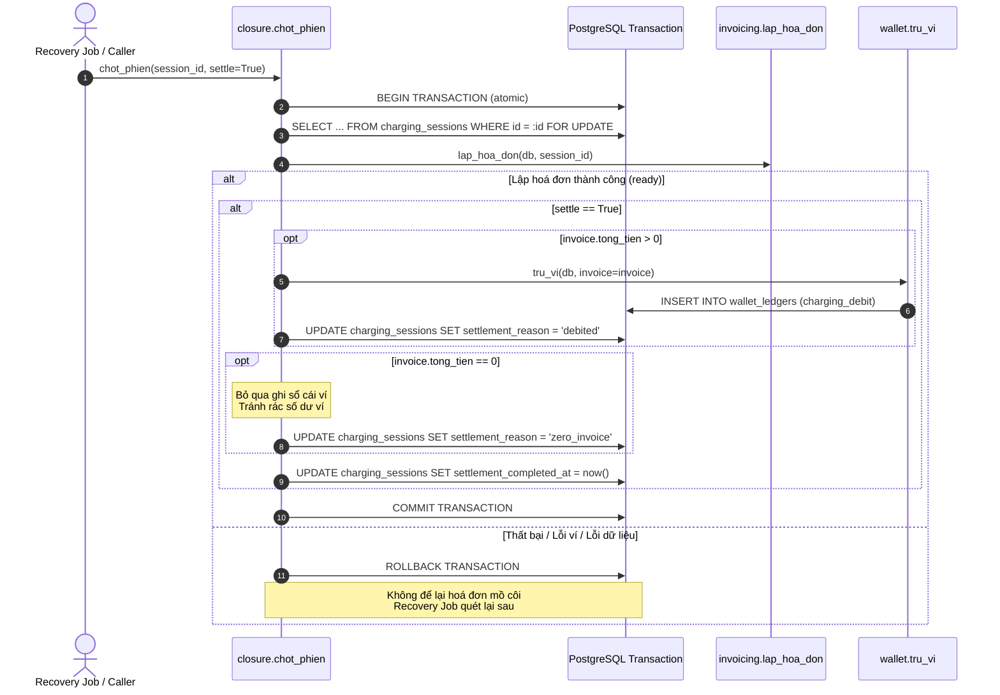

# Tài liệu Kỹ thuật T-102: Chốt phiên sạc và Trừ ví tự động (Story S-37)

## 1. Giới thiệu & Mục tiêu
- **Story**: S-37 - Ví bị trừ tự động khi phiên sạc kết thúc, có bản ghi giao dịch.
- **Task**: T-102 - Mở rộng quy trình chốt phiên (`chot_phien`), tích hợp lập hoá đơn và trừ tiền ví tự động trong một giao dịch cơ sở dữ liệu duy nhất, kèm cơ chế xử lý hoá đơn chuyển đổi (legacy exempt).

---

## 2. Thiết kế Giao dịch Nguyên tử (Atomic Settlement Transaction)

Hàm `chot_phien(session_id, db=None, settle=False)` tại `src/modules/billing/closure.py`:
Worker và vòng quét trong lifespan truyền `settle=True`; caller chỉ lập hoá đơn có thể giữ `False`.

### Các nguyên tắc cốt lõi:
1. **Khoá dòng (Row Lock)**:
   - Dùng `with_for_update()` trên dòng `ChargingSession` trong phiên giao dịch để tránh tranh chấp (race conditions) khi nhiều worker hoặc webhook gọi cùng lúc.
2. **Nguyên tử (Atomicity)**:
   - Lập hoá đơn (`lap_hoa_don`) và trừ tiền ví (`tru_vi`) thực hiện trên cùng một `Session` SQLAlchemy.
   - Nếu bất kỳ bước nào phát sinh ngoại lệ (ngoại lệ trừ ví, lỗi kết nối, v.v.), toàn bộ giao dịch được rollback. Không tồn tại hoá đơn "mồ côi" khi chưa settle thành công.
3. **Idempotency (Tính khả lặp)**:
   - Nếu hoá đơn đã được lập từ trước (`reused_existing = True`), quy trình tiếp tục kiểm tra trạng thái trừ ví để thực hiện trừ ví và cập nhật mốc thời gian hoàn tất chốt phiên.
   - Nếu phiên đã có `settlement_completed_at IS NOT NULL`, `chot_phien` trả về ngay mà không thực hiện trừ tiền lặp lại.
4. **Bảo vệ quyền riêng tư (Privacy & Logging)**:
   - Log ghi nhận tiến trình chỉ ghi `session_id`, `invoice_id`, `amount`, tuyệt đối **không ghi tên tài xế**.

---

## 3. Hoá đơn 0 đồng (`zero_invoice`)
- Với các phiên sạc có tổng tiền bằng 0 (ví dụ khuyến mãi 100%, hoặc không tiêu thụ điện):
  - Không tạo bản ghi `wallet_ledgers` (tránh rác sổ cái và tính toán số dư thừa thãi).
  - Đánh dấu `settlement_completed_at = now()`.
  - Đặt `settlement_reason = 'zero_invoice'`.

---

## 4. Xử lý Dữ liệu Quá khứ / Chuyển đổi (Migration: `legacy_exempt`)

- **Migration**: `migrations/versions/4db8d8987c3a_t102_legacy_exempt_settlement.py`
- **Mục đích**:
  - Với các hoá đơn được tạo ra trong các phiên bản trước (trước mốc chuyển đổi `cutoff`) chưa có dòng trừ ví tương ứng trong `wallet_ledgers`, hệ thống đánh dấu:
    - `settlement_reason = 'legacy_exempt'`
    - `settlement_completed_at = now()` (nếu đang null)
  - Giúp tránh việc quét chốt phiên sau khi triển khai hệ thống mới trừ đè tiền ví của các hoá đơn cũ đã được thanh toán ngoài luồng hoặc không cần trừ ví.
- **Cấu hình mốc Cutoff**:
  Mốc là bắt buộc, phải có timezone; chuẩn hóa UTC. Thiếu/sai mốc sẽ dừng trước DML.
  1. CLI Alembic: `alembic -x legacy_cutoff="2026-03-30T00:00:00+00:00" upgrade head`
  2. Biến môi trường: `LEGACY_SETTLEMENT_CUTOFF="2026-03-30T00:00:00+00:00"`
  3. Cài đặt hệ thống: `settings.legacy_settlement_cutoff` trong `src/config.py`.

### Quy trình chuyển đổi từng môi trường

1. Dừng backend/worker chốt phiên và các nguồn phát sinh hoá đơn, bao gồm OCPP.
2. Trưởng nhóm xác nhận mốc UTC có timezone cho môi trường. Không dùng giờ merge
   hoặc tự lấy giờ hiện tại làm mặc định. Sao lưu database theo quy trình hiện có.
3. Chạy Alembic bằng tài khoản migration, truyền mốc đã duyệt qua `-x legacy_cutoff`
   hoặc `LEGACY_SETTLEMENT_CUTOFF` trong env migration riêng. Mốc CI `1970-01-01`
   chỉ dành cho DB kiểm thử trống, không sao chép sang staging đang có dữ liệu.
4. Lưu log migration cùng môi trường, người duyệt, mốc, revision và bản sao lưu.
   Dòng audit ghi database, cutoff chuẩn UTC, số `legacy_exempt`, `debited`,
   `needs_review`. Kiểm tra dữ liệu và lưu kết quả vào hồ sơ triển khai trước restart.
5. Chỉ invoice trước mốc và không có dấu vết trừ liên quan mới được miễn trừ.
   Dòng trừ đúng ví/loại/tham chiếu/số tiền được nhận diện `debited` không ghi tiền lại.
   Dòng sai giữ `settlement_* = NULL`, thêm `settlement_ledger_mismatch` vào review.
   Không sửa/xoá invoice hoặc ledger. Invoice tại/sau mốc chưa trừ để job xử lý.
6. Khởi động lại worker sau khi kiểm tra. Đối chiếu invoice, balance, ledger,
   settlement và xác nhận lần quét kế tiếp không trừ thêm.

Deploy chạy preflight bằng môi trường migration, rồi migrate/cấp quyền trước khi
khởi động candidate. Lần chuyển đổi đầu bị chặn nếu backend cũ còn chạy, cutoff
thiếu/sai timezone hoặc nằm trong tương lai. Các lần deploy sau khi revision đã áp dụng
không yêu cầu dừng backend hay đặt lại mốc. Người vận hành vẫn phải xác nhận tất cả
nguồn tạo invoice khác đã dừng; preflight chỉ nhận diện container backend chính.

Nếu revision này từng được chạy trước khi bổ sung kiểm tra, `upgrade head` không
chạy lại revision đã áp dụng. Phải rà soát trạng thái dữ liệu và có kế hoạch chuyển đổi
riêng được trưởng nhóm duyệt; không tự downgrade để chạy lại trên dữ liệu tài chính.
Downgrade hiện xoá dấu `legacy_exempt`, không hoàn tiền và không xoá ledger.
Chỉ thực hiện khi worker dừng và có kế hoạch khôi phục đã xác nhận.

### Kiểm thử bổ sung

`tests/test_t102_transition.py` chạy hàm `upgrade()` của revision thật trên PostgreSQL
với invoice trước/tại/sau cùng mốc; kiểm số dư và ledger sau hai vòng quét.
Các ca thiếu/sai mốc hoặc thiếu timezone xác nhận không ghi dữ liệu.
Runtime kiểm tra ledger sai tham chiếu/loại/số tiền và nhận diện debit hợp lệ kể cả ví
đang locked. Lỗi sau khi ghi ví thực tế xác nhận rollback toàn bộ và job retry đúng một lần.

---

## 5. Ma trận AC và kiểm thử

| Tiêu chí | Kiểm thử |
| --- | --- |
| Invoice, debit và settlement cùng transaction; 0 đồng; idempotency | `tests/test_t102_closure_settlement.py` |
| Worker và recovery tự trừ ví | `tests/test_t102_closure_settlement.py`, `tests/test_t81_closure.py` |
| Trước/tại/sau cùng mốc, debit hợp lệ, ledger sai và quét sau chuyển đổi | `test_actual_revision_boundaries_existing_debit_and_review` |
| Thiếu/sai mốc/thiếu timezone dừng trước DML | `test_invalid_cutoff_fails_before_any_write` |
| CLI ưu tiên hơn environment và settings | `test_cutoff_configuration_precedence` |
| Ledger sai ví/loại/số tiền/tham chiếu không hoàn tất hay trừ thêm | `test_runtime_corrupt_ledger_stays_review_without_debit` |
| Debit cũ hợp lệ không trừ lại kể cả ví locked | `test_runtime_existing_valid_debit_not_charged_again` |
| Lỗi sau flush ví rollback toàn bộ, job retry | `test_failure_after_real_wallet_write_rolls_back_everything` |

Các test transition ở `tests/test_t102_transition.py`. Test PostgreSQL dùng database
riêng, không dùng dữ liệu staging. Log nghiệp vụ chỉ ghi mã phiên và số tiền;
log migration ghi mốc/database/count, không ghi tên tài xế hoặc connection string.
Kết quả CI và nghiệm thu chuyển đổi thực tế phải kiểm tra trên head đã cập nhật.
