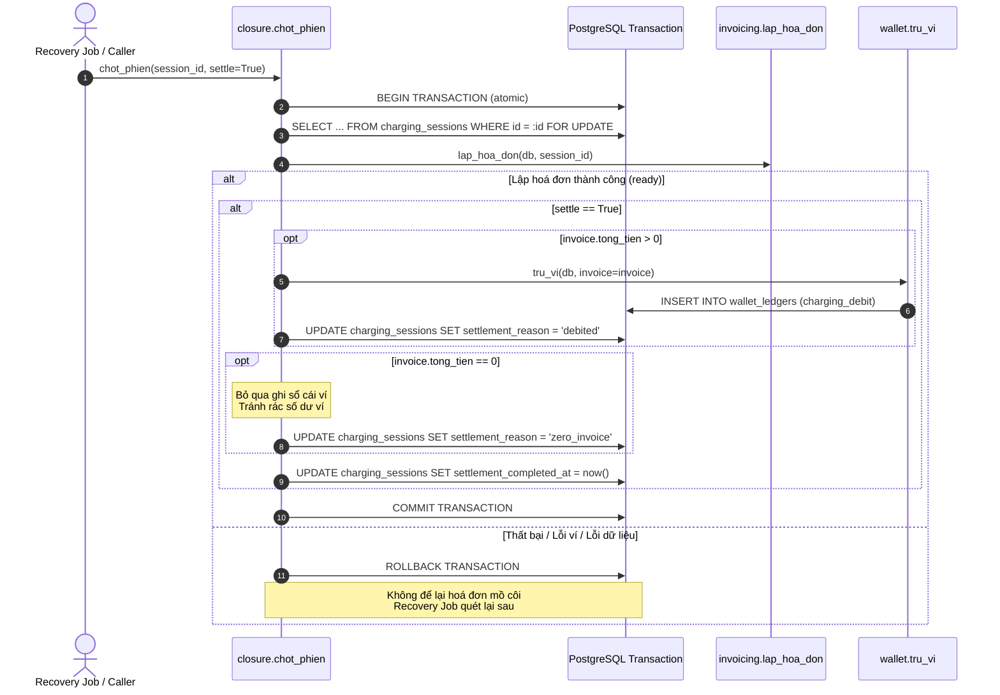

# Tài liệu Kỹ thuật T-102: Chốt phiên sạc và Trừ ví tự động (Story S-37)

## 1. Giới thiệu & Mục tiêu
- **Story**: S-37 - Ví bị trừ tự động khi phiên sạc kết thúc, có bản ghi giao dịch.
- **Task**: T-102 - Mở rộng quy trình chốt phiên (`chot_phien`), tích hợp lập hoá đơn và trừ tiền ví tự động trong một giao dịch cơ sở dữ liệu duy nhất, kèm cơ chế xử lý hoá đơn chuyển đổi (legacy exempt).

---

## 2. Thiết kế Giao dịch Nguyên tử (Atomic Settlement Transaction)

Hàm `chot_phien(session_id, db=None, settle=True)` tại `src/modules/billing/closure.py`:

### Các nguyên tắc cốt lõi:
1. **Khoá dòng (Row Lock)**:
   - Dùng `with_for_update()` trên dòng `ChargingSession` trong phiên giao dịch để tránh tranh chấp (race conditions) khi nhiều worker hoặc webhook gọi cùng lúc.
2. **Nguyên tử (Atomicity)**:
   - Lập hoá đơn (`lap_hoa_don`) và trừ tiền ví (`tru_vi`) thực hiện trên cùng một `Session` SQLAlchemy.
   - Nếu bất kỳ bước nào phát sinh ngoại lệ (ngoại lệ trừ ví, lỗi kết nối, v.v.), toàn bộ giao dịch được rollback. Không tồn tại hoá đơn "mồ côi" khi chưa settle thành công.
3. **Idempotency (Tính khả lặp)**:
   - Nếu hoá đơn đã được lập từ trước (`reused_existing = True`), quy trình tiếp tục kiểm tra trạng thái trừ ví để thực hiện trừ ví và cập nhật mốc thời gian hoàn tất chốt phiên.
   - Nếu phiên đã có `settlement_completed_at IS NOT NULL`, `chot_phien` trả về ngay mà không thực hiện trừ tiền lặp lại.
4. **Bảo vệ quyền riêng tư (Privacy & Logging)**:
   - Log ghi nhận tiến trình chỉ ghi `session_id`, `invoice_id`, `amount`, tuyệt đối **không ghi tên tài xế**.

---

## 3. Hoá đơn 0 đồng (`zero_invoice`)
- Với các phiên sạc có tổng tiền bằng 0 (ví dụ khuyến mãi 100%, hoặc không tiêu thụ điện):
  - Không tạo bản ghi `wallet_ledgers` (tránh rác sổ cái và tính toán số dư thừa thãi).
  - Đánh dấu `settlement_completed_at = now()`.
  - Đặt `settlement_reason = 'zero_invoice'`.

---

## 4. Xử lý Dữ liệu Quá khứ / Chuyển đổi (Migration: `legacy_exempt`)

- **Migration**: `migrations/versions/4db8d8987c3a_t102_legacy_exempt_settlement.py`
- **Mục đích**:
  - Với các hoá đơn được tạo ra trong các phiên bản trước (trước mốc chuyển đổi `cutoff`) chưa có dòng trừ ví tương ứng trong `wallet_ledgers`, hệ thống đánh dấu:
    - `settlement_reason = 'legacy_exempt'`
    - `settlement_completed_at = now()` (nếu đang null)
  - Giúp tránh việc quét chốt phiên sau khi triển khai hệ thống mới trừ đè tiền ví của các hoá đơn cũ đã được thanh toán ngoài luồng hoặc không cần trừ ví.
- **Cấu hình mốc Cutoff**:
  1. CLI Alembic: `alembic -x legacy_cutoff="2026-03-30T00:00:00+00:00" upgrade head`
  2. Biến môi trường: `LEGACY_SETTLEMENT_CUTOFF="2026-03-30T00:00:00+00:00"`
  3. Cài đặt hệ thống: `settings.legacy_settlement_cutoff` trong `src/config.py`.

---

## 5. Danh sách Test Cases (Đã kiểm thử 100% Pass)
Được triển khai trong `tests/test_t102_closure_settlement.py`:
1. `test_t102_chot_phien_thanh_cong_co_phi_tru_vi_va_danh_dau_debited`: Chốt phiên có phí, trừ ví thành công, cập nhật `debited`.
2. `test_t102_chot_phien_hoa_don_0_dong_danh_dau_zero_invoice_khong_ghi_ledger`: Hoá đơn 0đ, không ghi sổ cái, đánh dấu `zero_invoice`.
3. `test_t102_nguyen_tu_loi_tru_vi_rollback_khong_mo_coi_hoa_don`: Lỗi trừ ví rollback toàn bộ, không sót hoá đơn mồ côi.
4. `test_t102_idempotent_chot_phien_nhieu_lan_khong_tru_vi_dup`: Gọi lặp lại không bị trừ tiền 2 lần.
5. `test_t102_chot_phien_tai_su_dung_hoa_don_da_lap_truoc_do`: Tái sử dụng hoá đơn sẵn có và trừ ví an toàn.
6. `test_t102_settle_false_chi_lap_hoa_don_khong_tru_vi`: Cho phép tham số `settle=False` chỉ lập hoá đơn (tương thích test cũ).
7. `test_t102_migration_legacy_exempt_offline`: Đánh dấu các phiên lịch sử sang `legacy_exempt`.
8. `test_t102_log_khong_ghi_ten_tai_xe`: Kiểm tra assertion trong log không rò rỉ tên người dùng.
